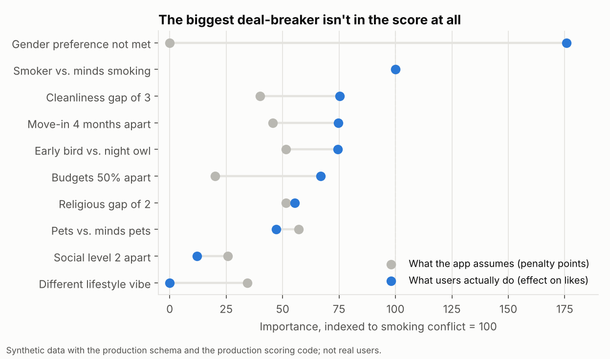
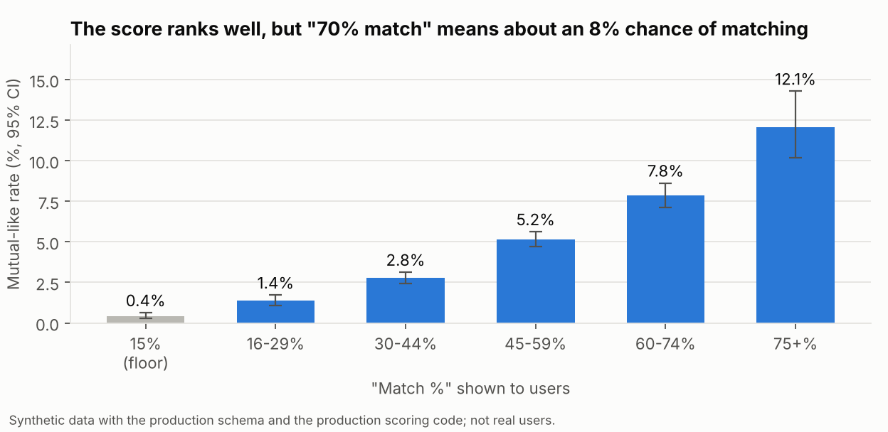
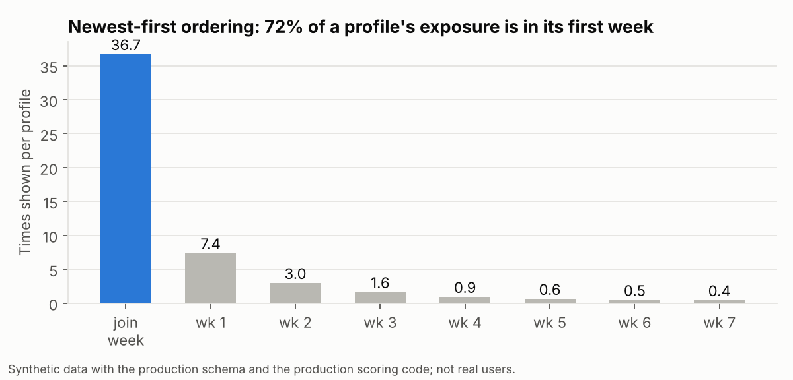
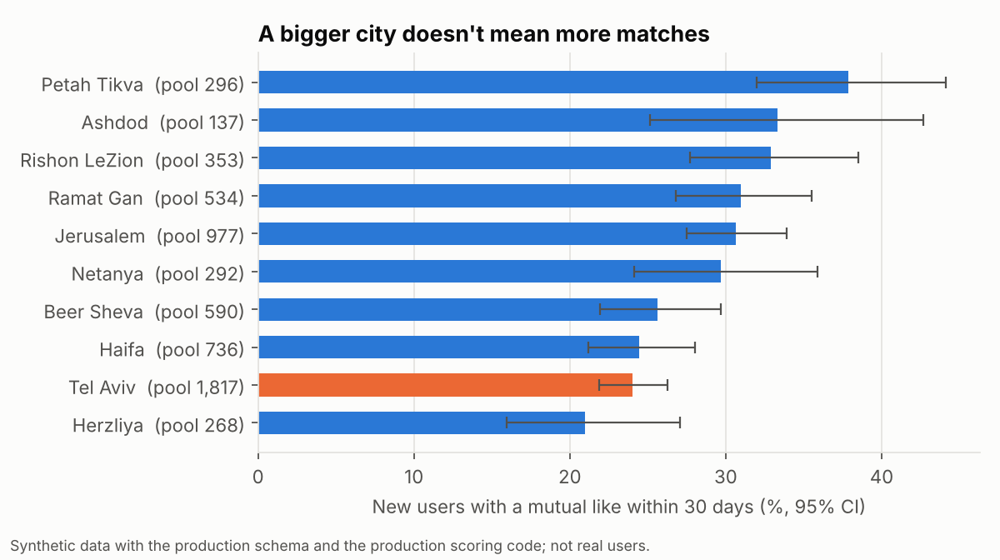

# Does our "match %" actually predict who connects?

**Matching and marketplace analysis for RooMatch, a roommate-matching app for students and young adults in Israel that I built.**


> **About the data.** RooMatch's profiles hold sensitive personal data: religious
> level, smoking, age, gender, private messages. None of it is here. This repo runs on
> **synthetic data with the production schema**, scored by **the production matching
> algorithm itself**. It is ported to Python and verified against the app's TypeScript on
> 1,500 random pairs, with zero differences. No names, photos, phone numbers or message text
> are generated, even fake ones.

---

## The short version

Users swipe through a deck of potential roommates, and every card shows a
**"NN% match"** from a hand-written scoring function with about 20 hand-set weights. Nobody had
checked whether that number predicts anything.

| Question | Answer |
|---|---|
| **Does the score predict connections?** | **Yes, it ranks pairs well** (mutual-like rate 0.4% at the bottom → 12% at the top), **but it isn't a probability.** A "70% match" becomes a mutual like about 8% of the time. |
| **Are the weights right?** | **No.** The strongest deal-breaker in behaviour, an unmet **gender preference**, carries **zero weight** in the score and isn't filtered: 23% of cards break the viewer's own stated preference. Budget, cleanliness, sleep and move-in timing are under-weighted; "lifestyle vibe" carries 10% of the base weight and has no effect. Re-weighting lifts AUC on unseen users from **0.65 to 0.79**. |
| **Are good matches lost?** | **Most are.** **78% of likes go to someone who never sees the liker**, because the deck shows newest profiles first and 72% of a profile's exposure happens in its first week. |
| **Is the market liquid everywhere?** | **Bigger isn't better.** Tel Aviv, the largest pool, matches new users *less* often (24%) than Jerusalem (31%) or Petah Tikva (38%). |
| **Decision** | 1) Filter by gender preference. 2) Add a "they liked you" queue, the largest lever (model estimate: several times today's mutual likes). A/B test it at about 1,320 users per arm. 3) Re-weight the score from data. 4) Relabel "% match" as tiers. |

<p align="center"></p>

---

## What this project shows

| Skill | Where |
|---|---|
| Treating a product heuristic as a model, and validating it against outcomes | [Q1](#q1-does-the-score-predict-who-connects) |
| Reading production code to find data and logic problems before analysing | [Found in code review](#found-in-code-review-before-touching-data) |
| Logistic regression with a popularity control, user-level train/test split, marginal effects | [Q2](#q2-which-factors-actually-drive-likes) |
| Two-sided marketplace thinking: liquidity, exposure, reciprocity | [Q3](#q3-are-good-matches-getting-lost), [Q4](#q4-is-the-market-liquid-everywhere) |
| SQL with honest denominators (mutual rate only over pairs who *both* saw each other) | [`sql/`](sql) |
| Turning findings into a ranked plan and a sized A/B test | [Recommendations](#recommendations) |
| Proving the method works: it recovers planted effects and finds none where none exist | [`tests/test_analysis.py`](tests/test_analysis.py) |
| Verifying a port against production code | [`tests/test_score_port.py`](tests/test_score_port.py) |

---

## The product and the data

```
profiles                   ~30 self-reported fields: city, budget (₪), age, gender, gender_preference,
                           sleep_schedule, cleanliness (1-5), smoking_preference, religious_level, ...
swipes                     viewer_id · target_id · direction (like/pass) · match_percent · deck_position · swiped_at
liked_profiles             user_id · liked_user_id · created_at            (production table)
conversations              id · created_at
conversation_participants  conversation_id · user_id
messages                   conversation_id · sender_id · created_at         (no content: it isn't needed)
```

The funnel: **card shown → like → mutual like → conversation → two-way chat**
(both people sent at least 2 messages).

### Found in code review, before touching data

I read the app's matching and deck code first. Each item changes how the data
has to be analysed:

| What the code does | Why it matters for the analysis |
|---|---|
| **Passes are logged without the target or the score.** PostHog's `swipe_dislike` has no properties. | You can't compute "like rate by score" from production events. **First recommendation:** log `target_id` and `match_percent` on every swipe. The `swipes` table here is that instrumented log. |
| **`gender_preference` is collected and never used.** It is not in the score and not in the deck query. | A likely huge, invisible deal-breaker. Measured in Q2. |
| **The "suppression threshold" of 15 suppresses nothing.** Scores are *clamped* to 15 and still shown. | 15% of all cards shown are floor-level pairs. A real filter is a product decision; the data quantifies it. |
| **The deck is newest-first, not by score.** | Good news for analysis: exposure doesn't depend on score, so the score can be validated without position bias. Bad news for users: older profiles disappear (Q3). |
| **The score can exceed 100%.** The move-in bonus is applied as a negative penalty. | A minor display bug, confirmed by running the production TypeScript (a pair scores 101). |
| **Answer scales are mapped onto a 7-step scale unevenly.** Cooking options *Never / Rarely / Sometimes / Daily* sit at steps 0, 1, 2, 6. | "Rarely vs Sometimes" counts as 1/6 apart, but "Sometimes vs Daily" counts as 4/6. Similarity on these fields is distorted. |
| **Onboarding defaults (age 18–40, "No preference") are pre-filled.** | Defaults look like answers. Any analysis of preferences must treat them as possibly unanswered. |

## Method

1. **Port and verify the score.** [`roomatch/score.py`](roomatch/score.py) reproduces
   `calculateUserMatch`, including JavaScript's rounding, and exposes every component.
   [`tests/test_score_port.py`](tests/test_score_port.py) compares it with the production
   TypeScript on 1,500 random pairs, including missing values, and finds no differences.
2. **SQL for the funnel and the marketplace** ([`sql/`](sql)). Mutual rate is computed
   only over pairs where **both** people saw each other. Otherwise the deck's ordering
   would be blamed on the score.
3. **A pair-level model of likes.** A logistic regression on 325,054 swipes, with one
   feature per scoring factor plus the factor the app ignores, gender preference.
   - **Popularity control.** Each target's leave-one-out like rate absorbs
     photos and bio, so attractive profiles don't get credited to "compatibility".
   - **Split by user, not by row.** Tested on 30% of *viewers* the model never saw,
     which is how a new score would meet new users.
   - **Effects in percentage points,** averaged over real swipes for a "standard
     conflict" (for example budgets 50% apart). This puts the app's points and the
     users' behaviour on one scale.
4. **Validated on a known truth.** The synthetic users choose by a hidden rule
   (`TRUE_EFFECTS` in the [generator](data/generate_synthetic.py)) that deliberately
   disagrees with the app. The tests require the analysis to recover every planted
   effect within 30% and to find nothing for the factor planted at zero.

## Findings

Numbers come from [`analysis/findings.md`](analysis/findings.md), which the script regenerates on every run.

### Q1. Does the score predict who connects?

<p align="center"></p>

| "Match %" shown | Cards | Like rate | Mutual-like rate* | Two-way chats* |
|---|---|---|---|---|
| 15 (floor) | 48,686 | 5.7% | 0.4% | 0.04% |
| 16–29 | 51,161 | 10.0% | 1.4% | 0.2% |
| 30–44 | 83,300 | 14.5% | 2.8% | 0.5% |
| 45–59 | 87,240 | 20.0% | 5.2% | 0.9% |
| 60–74 | 45,712 | 25.7% | 7.8% | 2.1% |
| 75+ | 8,955 | 32.0% | 12.1% | 4.0% |

<sub>*Per pair in which both people saw each other.</sub>

- **The ranking works.** Every band beats the one below, and the top band matches
  nearly 30× more often than the floor (AUC 0.65 for a like).
- **The label misleads.** "70% match" sounds like a 70% chance. It is about 8%. That
  sets expectations the product can't meet.
- **The floor is noise.** 15% of all cards are floor pairs that almost never match,
  a sixth of every user's swipes spent on them.

### Q2. Which factors actually drive likes?

The chart at the top compares each factor's weight in the app with its effect on
real likes, both indexed to a smoking conflict = 100.

| Verdict | Factors (behaviour index vs app index, smoking = 100) |
|---|---|
| **Missing** | **Gender preference not met: −18.6 pp**, the largest effect of all. 23% of cards break the viewer's stated preference. |
| **Under-weighted** | Budgets 50% apart (−7.1 pp; 67 vs 20), cleanliness gap of 3 (75 vs 40), move-in 4 months apart (75 vs 46), early bird vs night owl (74 vs 51) |
| **About right** | Smoking (anchor), religious gap (55 vs 51), pets (47 vs 57) |
| **Over-weighted** | Lifestyle vibe (no effect; 10% of base weight), social level (12 vs 26) |

**Does fixing it help?** On users the model never saw:

| Ranking signal | AUC for a like |
|---|---|
| Current score | 0.646 |
| Current score + profile popularity | 0.697 |
| Same factors, weights learned from behaviour | 0.719 |
| …plus gender preference | **0.790** |

### Q3. Are good matches getting lost?

<p align="center"></p>

- **78% of likes can never become a match:** the person liked never sees the liker.
- Mechanism: the deck is newest-first in pages of 50, so a profile is shown about 37
  times in its first week and under once a week from week 4. Users who joined earlier
  simply stop appearing.
- When people *do* see someone who liked them, they like back 23% of the time,
  against a 16% base like rate.
- **A "they liked you" queue** that shows pending likers first: 23,281 of the unseen
  likes went to people who opened the app again afterwards. At the like-back rates the
  model predicts, that is about **5,100 extra mutual likes on top of today's 1,321**.
  This is an upper-bound model estimate, so it is the first thing to A/B test.

### Q4. Is the market liquid everywhere?

<p align="center"></p>

- Tel Aviv has the largest pool, yet matches new users within 30 days **less often**
  (24.0%, 95% CI 21.9–26.3) than Jerusalem (30.6%, 27.5–33.9). Correlation between
  pool size and match rate across cities: −0.41.
- Same mechanism as Q3: in a big city, newer profiles bury yours faster. The fix is
  ordering, not more users. More sign-ups in Tel Aviv would make this worse.

## Recommendations

| # | Change | Why | Effort |
|---|---|---|---|
| 1 | **Respect gender preference** (deck filter) | The largest deal-breaker; 23% of cards wasted | Small |
| 2 | **"They liked you" queue** before the regular deck | 78% of likes are never seen. The largest lever. | Medium |
| 3 | **Learned weights** (refit quarterly), and drop "lifestyle vibe" | AUC 0.65 → 0.79 on unseen users | Medium |
| 4 | **Show tiers instead of "%"** ("Great fit", "Good fit") and actually hide floor pairs | "70%" promises what it can't deliver; 15% of cards are near-zero | Small |
| 5 | **Log passes with `target_id` and `match_percent`** | Without it, none of this can be monitored in production | Small |
| 6 | Fix the >100% bug and the uneven answer scales | Data quality | Small |

**Experiment for #2:** randomise new users 50/50. Primary metric: share with a
mutual like within 30 days (baseline 27.5%). Detecting +5 pp at α = 0.05 and 80%
power needs **about 1,320 users per arm**. Guardrails: like rate, report rate, and
messages per conversation, so we know the queue isn't creating low-quality matches.

## Limitations

- **Synthetic data.** The real deliverable is the method, the code-review findings
  (which are real) and the tests that prove the method recovers known effects. The
  numbers describe the simulated market, not RooMatch's users.
- Logistic coefficients are slightly attenuated, because each viewer's pickiness is
  unobserved. Rankings and verdicts are unaffected (see the recovery tests).
- The "liked you" estimate assumes people like back from a queue as they would from the
  deck. Only an experiment can confirm that.

## Reproduce

```bash
pip install -r requirements.txt
python data/generate_synthetic.py     # 6,000 profiles, 325k swipes (~15 s)
python analysis/run_analysis.py       # SQL → model → figures → findings.md (~25 s)
python -m pytest -q                   # 23 tests: port, data quality, effect recovery
```

## Repository map

```
roomatch/score.py        production matching score, ported and verified
sql/                     funnel by score band, unseen likes, exposure decay, city liquidity (DuckDB SQL)
analysis/                run_analysis.py · findings.md · results.json · aggregates/
data/                    generate_synthetic.py: schema-faithful market with a known hidden truth
tests/                   port vs TypeScript · data-quality checks · planted-effect recovery
figures/                 charts above
DASHBOARD.md             what the admin dashboard tracks today, and the match-health view it needs
```
